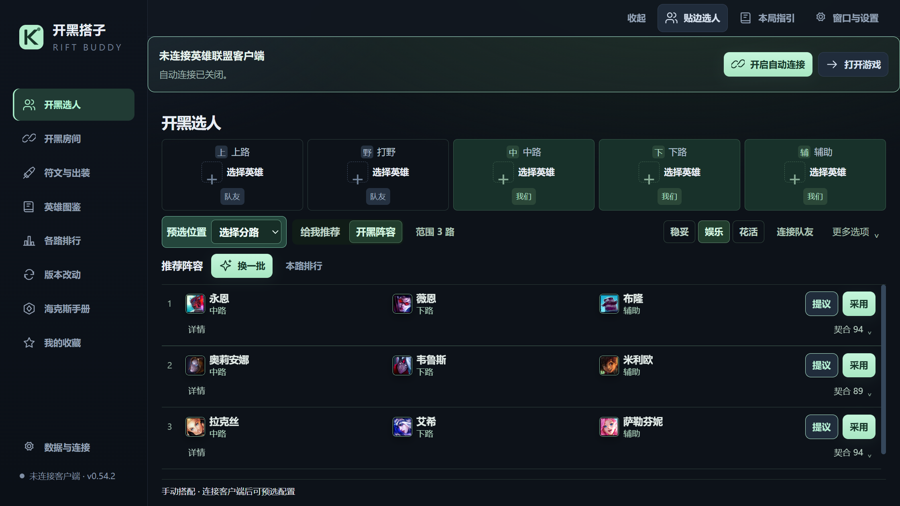
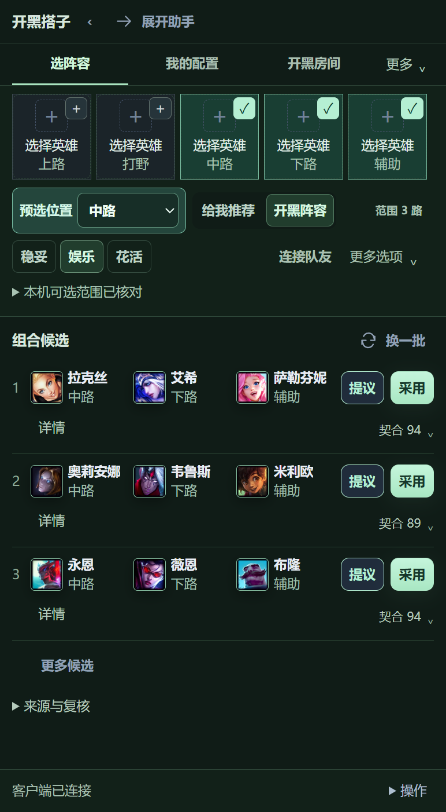
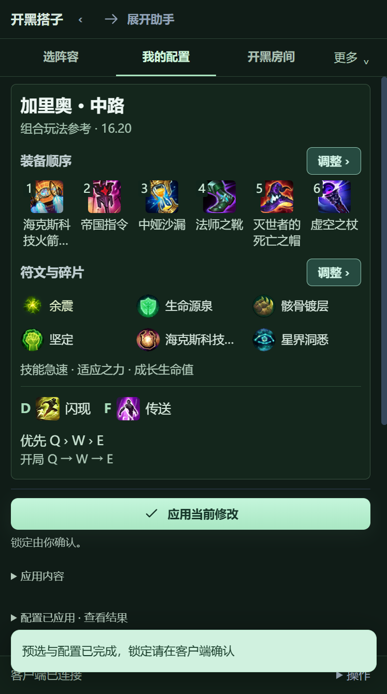
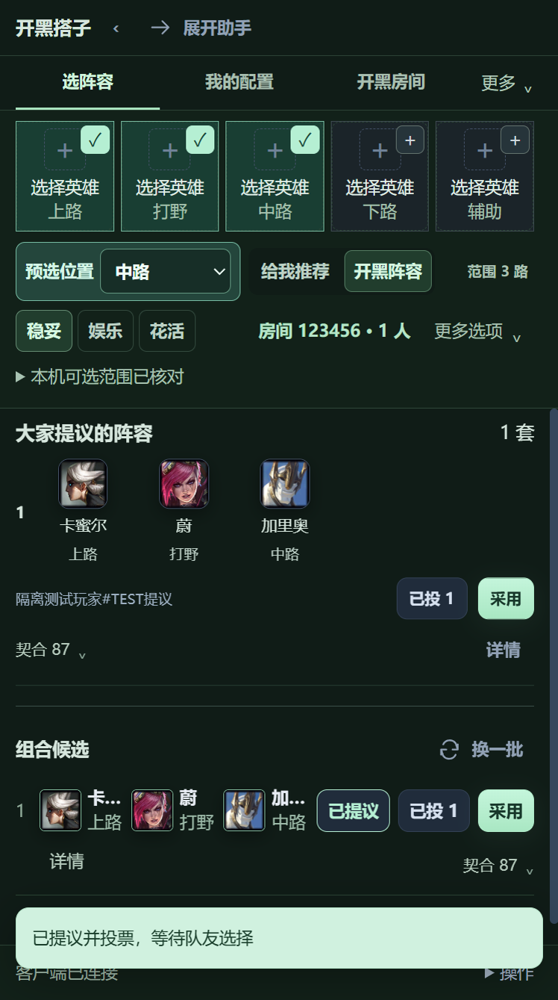
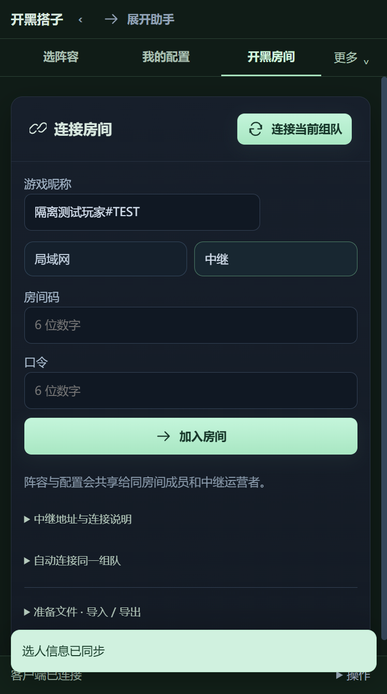
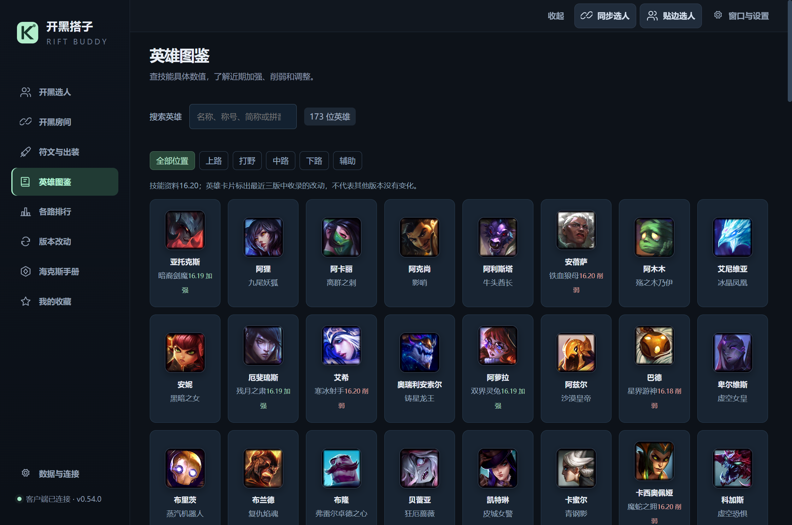
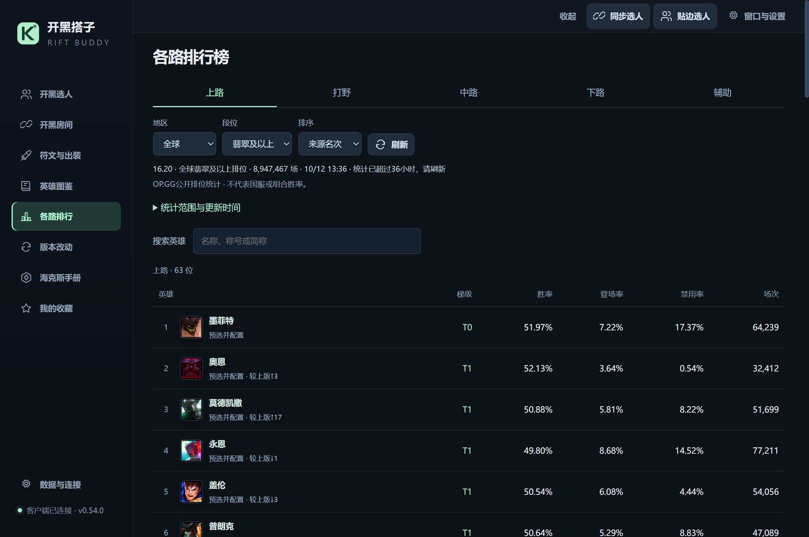

<h1 align="center">开黑搭子 · Rift Buddy</h1>

<strong>选好阵容，一起开黑。</strong>

英雄联盟朋友开黑助手 · Windows x64 · 免费使用 · <strong>v0.54.2</strong>

  <a href="https://room.riftbuddy.dpdns.org/downloads/"><strong>下载安装包</strong></a> ·
  <a href="https://gitee.com/legender134/rift-buddy/releases">Gitee 国内镜像</a> ·
  <a href="https://github.com/Legender134/rift-buddy/releases">GitHub Releases</a> ·
  <a href="docs/releases/v0.54.2.md">本次更新</a>

从组队大厅到选人，再到符文装备和开局分工，把开黑前的准备放在顺手的位置。支持单人参考和二至五人搭配，主界面与贴边侧栏可以同时使用。

当前版本 **0.54.2**：点击英雄直接预选并配置，提议与投票集中展示，开黑房间独立进入。

## 在侧栏里，选好这局怎么玩

读取公开组队和选人信息，自动填入实际英雄；位置可以手动调整。默认围绕“我们”推荐，只有自己一人时参考全队，仍只更换自己的选择。

- 比较候选的英雄、分路与契合参考，详细依据按需展开。
- 已选队友和手动位置保留，推荐随实际选人变化。
- 选择预选位置可先用该路代表英雄占位，继续挑阵容。

## 点自己的英雄，接着选配置

点击可选英雄头像，直接预选并准备对应符文、召唤师技能和商店装备集，不受方案分路限制。**默认保留闪现 D/F 键位，最终锁定由你确认。**

<table>
  <tr>
    <td width="50%"> <strong>先比较阵容</strong> 队伍、位置和候选集中在侧栏。</td>
    <td width="50%"> <strong>再核对配置</strong> 完整装备顺序、符文、D/F 和加点直接查看。</td>
  </tr>
</table>

组合有专用配置时优先使用；其余使用常用来源参考。可以调整路线或逐项自选，自己的有效修改会保留。预览和调整本身不写入客户端，修改后再点击应用。

## 和队友，用同一套方案

在支持的单人或预组队大厅自动连接助手房间，昵称跟随游戏；房间页可重新连接当前组队，也可手动加入。向队友提议阵容、投票和共享配置。可同时支持多套阵容，每套最多一票，再点可撤回；采用后查看每位成员的开局任务、配合条件和退出安排。

没有安装助手的朋友仍可作为公开队友参与阵容参考；房间在线成员与游戏组队成员分别显示。

## 查资料，也看清来源

英雄图鉴提供技能数值、冷却、消耗与近期改动；五路排行保留地区、段位、样本和统计时间，选人时也能查。

榜单、常用配置和海克斯参考由资料服务每日两次检查。更新经过签名和完整性校验，选人、对局期间先暂存，空闲后启用；断网仍可使用有效缓存。

进入对局后，按需使用小型装备、加点和野区路线参考窗口。窗口可以移动、调整大小、收起或关闭，设置中可恢复默认布局。

## 三步开始

1. **安装并打开助手。** 点击“打开英雄联盟”，或先开客户端再开助手；程序会自动检测连接。
2. **和朋友选阵容。** 核对“我们”的范围和位置，比较候选，点击自己的英雄准备配置。
3. **客户端确认锁定。** 进入游戏后按需查看开局分工和局内参考。

普通使用不需要 Node.js 或开发工具。[完整使用指南](使用说明.txt)包含连接、配置、快捷键和设置说明。

<strong>下载、Gitee 分卷与软件更新</strong>

| 入口 | 使用方式 |
| --- | --- |
| [统一下载页与服务器备用包](https://room.riftbuddy.dpdns.org/downloads/) | 直接下载安装程序，支持断点续传 |
| [GitHub Releases](https://github.com/Legender134/rift-buddy/releases) | 安装程序、版本说明与 SHA-256 校验文件 |
| [Gitee 国内镜像](https://gitee.com/legender134/rift-buddy/releases) | 下载全部 `.part` 和同版 `Merge.cmd` 到同一目录，合并后安装 |

程序内可在“设置 → 软件更新”检查新版，选择 GitHub 或 Gitee，下载并校验后点击“退出并安装”。Gitee 分卷由程序自动合并；手动下载时无需安装解压工具。

安装包版本与校验值以下载页为准，三个入口分发相同原始安装包。

<strong>适用范围、资料与隐私</strong>

- 支持 Windows x64，围绕英雄联盟峡谷选人与海克斯参考提供准备；具体功能取决于客户端公开接口和当前模式。
- 通过本机公开接口连接客户端，不读取游戏内存。不会自动锁定、购买或升级技能；不提供敌方来抓检测或真实技能冷却追踪。
- 契合分是机制规则参考，不是胜率；来源统计不等于国服统计，人工玩法按各自复核记录维护。
- 不需要助手账号。个人配置和收藏保存在本机；房间共享内容可被房间成员与中继运营者看到。
- 截图使用本版程序与演示阵容。真实客户端兼容、整局性能和多屏显示仍需持续实测；当前已知限制见[本次更新](docs/releases/v0.54.2.md)。

资料来源包括 Riot Data Dragon、CommunityDragon、腾讯中文资料与 OP.GG。[第三方来源与许可](THIRD_PARTY_NOTICES.md)。本项目不是 Riot Games 或腾讯的官方产品。

## 反馈与参与

遇到问题，请附上**操作步骤、客户端阶段、助手版本和相关截图**，不要上传客户端连接文件、口令或带令牌的日志。

[GitHub Issues](https://github.com/Legender134/rift-buddy/issues) · [Gitee Issues](https://gitee.com/legender134/rift-buddy/issues) · [开发指南](CONTRIBUTING.md) · [组合库维护](组合库维护说明.txt)
