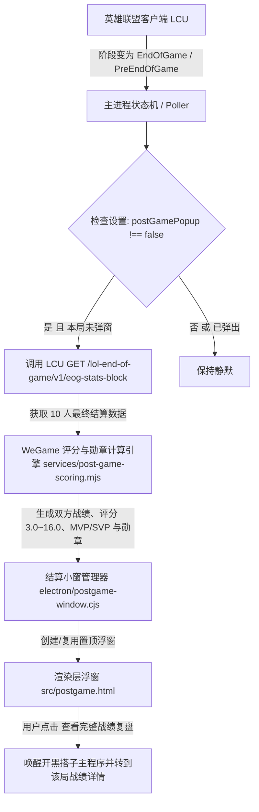

# 赛后评分弹窗与 WeGame 风格评分机制设计规范 (Design Spec)

## 1. 目标与范围

为开黑搭子（Rift Buddy）增加赛后自动弹出结算小窗与对标 WeGame 的综合战力评分机制：
1. **触发时机**：每局游戏结束（客户端进入 `EndOfGame`、`WaitingForStats` 或 `PreEndOfGame` 阶段，或检测到游戏进程关闭回到大厅）时，自动触发赛后结算流程。
2. **展示形式**：以独立的轻量置顶无边框悬浮小窗（`postgame-window`）呈现在屏幕中央或右下，支持拖拽、一键关闭（按 Esc 或右上角 `×`），不抢操作焦点。
3. **展示内容**：标定双方 10 名选手的 WeGame 综合战力评分（3.0 ~ 16.0 分制）、击杀/死亡/助攻、最终出装，高亮标记胜方最佳（MVP）与败方最佳（SVP），并评定全场与队内荣誉勋章（输出最高、血肉之盾、理财大师、推塔狂魔、视野先锋、团战先锋等）。
4. **安全与合规红线**：严格遵守《AGENTS.md》安全规范，数据完全来自 LCU 官方只读回环接口 `GET /lol-end-of-game/v1/eog-stats-block`（或对局回放与战绩接口），绝不读取游戏内存，绝不模拟键盘鼠标按键。
5. **设置项控制**：在设置“窗口与显示”中提供开关：`对局结束后自动弹出赛后评分与荣誉小窗`（默认开启，可随时关闭）。

---

## 2. 系统架构与数据流转



---

## 3. WeGame 评分算法与勋章评定模型 (3.0 ~ 16.0 分制)

### 3.1 核心数学公式与区间约束

评分引擎位于 `services/post-game-scoring.mjs`，为纯函数实现，输入单局队伍与选手数据，输出各选手的综合评分与荣誉标签。

* **基础分值范围**：
  评分区间严格限制在 `[3.0, 16.0]`。
  * 下限保底：3.0 分（挂机、极度低迷、0 贡献选手的保底分数）。
  * 上限封顶：16.0 分（全场通天代、完美发挥的理论满分）。
  * 标准基线：平均发挥的普通表现基线分为 9.0 ~ 10.5 分。
  * 浮点精度：保留一位小数（如 `15.4`、`13.8`、`8.2`、`3.0`）。

* **多维度权重构成**：
  综合得分由七大维度线性与非线性加权求和得出：

  `RawScore = Base + S_kda + S_dmg + S_tank + S_kp + S_eco + S_vision + S_obj + S_win`

  其中：
  1. **基准分 (Base)**：常数 5.5。
  2. **KDA 战损分 (S_kda)**，满分 3.5 分：
     采用平方根平滑衰减，避免过分保 KDA 导致的畸高得分：
     `S_kda = clamp(sqrt(max(KDA - 0.5, 0)) × 1.35, 0, 3.5)`
  3. **输出贡献分 (S_dmg)**，满分 3.0 分：
     基于在队伍总伤害中的占比 damageShare：
     * C位（中单/射手/输出上单）：`linear(damageShare, 0.10, 0.35, 3.0)`
     * 辅助位：`linear(damageShare, 0.05, 0.18, 1.2)`
  4. **承伤贡献分 (S_tank)**，满分 2.5 分：
     基于在队伍总承受伤害中的占比 damageTakenShare：
     * 坦克/前排/辅助：`linear(damageTakenShare, 0.12, 0.35, 2.5)`
     * 射手/脆皮中单：`linear(damageTakenShare, 0.08, 0.22, 1.2)`
  5. **参团率分 (S_kp)**，满分 2.5 分：
     基于击杀与助攻占全队总击杀的比例 `KP = (Kills + Assists) / max(1, TeamKills)`：
     * 辅助/打野：`linear(KP, 0.30, 0.75, 2.5)`
     * 单带上单/其余分路：`linear(KP, 0.25, 0.70, 2.0)`
  6. **经济与补刀分 (S_eco)**，满分 1.5 分：
     基于分均补刀与全队金币占比：
     * 非辅助位：`linear(CS/min, 3.0, 9.5, 1.5)`
     * 辅助位（自动豁免补刀）：`linear(GoldShare, 0.08, 0.18, 1.5)`
  7. **视野分 (S_vision)**，满分 1.5 分：
     基于分均视野得分 Vision/min：
     * 辅助/打野：`linear(Vision/min, 0.8, 2.2, 1.5)`
     * 其余分路：`linear(Vision/min, 0.3, 1.0, 0.8)`
  8. **推塔与地图资源分 (S_obj)**，满分 1.0 分：
     基于防御塔伤害与史诗级野怪参与。
  9. **胜负加成与惩罚 (S_win)**：
     获胜队伍选手统一增加 +0.8 分，失败队伍扣除 -0.4 分；若单局提前投降或掉线挂机（`WAS_SURRENDER_OR_AFK`），强制扣除至 3.0 分。

### 3.2 MVP 与 SVP 评定标准

* **MVP (Most Valuable Player，金色勋章)**：
  获胜方（Winning Team）中**最终评分最高**的选手。
* **SVP (Second Valuable Player，红色勋章)**：
  失败方（Losing Team）中**最终评分最高**的选手。

### 3.3 WeGame 风格荣誉勋章评定表

每个选手最多同时展示 3 个最高优先级的勋章，避免标签堆叠：

| 勋章标识 | 勋章名称 | 触发条件 | 视觉样式 |
| :--- | :--- | :--- | :--- |
| `mvp` | **MVP** | 获胜队伍评分第 1 名 | 金色渐变徽标，强阴影 |
| `svp` | **SVP** | 失败队伍评分第 1 名 | 玫红渐变徽标，强阴影 |
| `damage-king` | **输出最高** | 全场对英雄伤害最高（或本队且超 30%） | 炽橙色胶囊，文字标注数值（如 `38.2k`） |
| `tank-king` | **血肉之盾** | 全场承受伤害最高（或本队且超 30%） | 冰蓝色胶囊，文字标注数值（如 `34.5k`） |
| `rich-king` | **理财大师** | 全场获得金币最多 | 暖黄色胶囊，文字标注数值（如 `15.6k`） |
| `kp-king` | **团战先锋** | 本队参团率最高且 KP ≥ 65% | 翡翠绿胶囊 |
| `turret-king` | **推塔狂魔** | 全场防御塔伤害最高且对塔伤害 ≥ 3,500 | 琥珀色胶囊 |
| `vision-king` | **视野先锋** | 全场视野得分最高且视野分 ≥ 35 | 紫罗兰色胶囊 |
| `kill-king` | **击杀之神** | 全场击杀数最多且击杀 ≥ 8 | 暗红色胶囊 |
| `assist-king` | **助攻王** | 全场助攻数最多且助攻 ≥ 12 | 靛青色胶囊 |

---

## 4. 接口协议与路由变更

### 4.1 LCU 本地白名单扩充 (`services/lcu.mjs`)

将结算端点纳入 `GET_PATHS` 严格只读集合：
* 增加 `'/lol-end-of-game/v1/eog-stats-block'` 到 `GET_PATHS`。

### 4.2 数据返回结构清洗 (`cleanEndOfGameStats`)

LCU 返回的 `eog-stats-block` 原始 JSON 约 50KB~150KB，主进程清洗为轻量传输对象，移除无效字段：
```typescript
interface CleanPostGameReport {
  gameId: number;
  gameMode: string;
  gameDuration: number; // 单位：秒
  isWin: boolean;       // 当前玩家是否获胜
  selfPuuid: string;
  teams: CleanPostGameTeam[];
}

interface CleanPostGameTeam {
  teamId: number;       // 100 蓝方, 200 红方
  isWin: boolean;
  totalKills: number;
  totalDamage: number;
  totalGold: number;
  objectives: {
    baron: number;
    dragon: number;
    tower: number;
  };
  players: CleanPostGamePlayer[];
}

interface CleanPostGamePlayer {
  puuid: string;
  summonerName: string;
  championId: number;
  level: number;
  isSelf: boolean;
  kills: number;
  deaths: number;
  assists: number;
  kdaRatio: number;
  killParticipation: number; // 0 ~ 1
  damageDealt: number;
  damageShare: number;       // 0 ~ 1
  damageTaken: number;
  goldEarned: number;
  cs: number;
  items: number[];           // 7 件装备 (6 主装 + 1 饰品)
  score: number;             // 3.0 ~ 16.0
  badges: string[];          // ['mvp', 'damage-king', ...]
}
```

---

## 5. 窗口管理器与交互设计 (`electron/postgame-window.cjs`)

### 5.1 窗口规格与属性
* **尺寸与位置**：
  * 窗口宽 `760px`，高 `540px`。
  * 默认居中置于游戏主显示器，允许拖动。
* **窗口行为**：
  * `frame: false`、`transparent: true`、`alwaysOnTop: true`（设为 `'screen-saver'`）。
  * `skipTaskbar: true`、`focusable: true`（允许点击与滚动，不抢全屏游戏的输入焦点）。
  * 支持快捷键 `Escape` 立即关闭窗口。
  * 当客户端重新进入选人或游戏开始阶段时（`ChampSelect` / `GameStart`），自动平滑隐藏或销毁，绝不遗留遮挡下一局选人。

### 5.2 渲染层界面架构 (`src/postgame.html` / `src/postgame.mjs` / `src/postgame.css`)

* **顶栏 Header**：
  * 对局结果大标签：`胜利 VICTORY`（青蓝微光）或 `失败 DEFEAT`（鲜红微光）。
  * 模式信息：`单双排位 · 召唤师峡谷 · 32:45 · 对局 ID`。
  * 关闭按钮 `×`。
* **双列对战表格**：
  * 左右双列并排展示蓝方与红方（获胜队伍排左侧，失败队伍排右侧）。
  * 队伍头标：胜负标记、总击杀、总经济、史诗龙/塔数量。
  * 选手卡片：
    * 英雄头像（40px 圆角带等级徽标）。
    * 召唤师名称（本人带 `你` 并用天蓝色加亮背景）。
    * 击杀/死亡/助攻、参团率。
    * 勋章集群：MVP/SVP 专有渐变徽标，伤害最高/承伤最高胶囊。
    * 右侧高光大字 WeGame 评分：高分（`>=13.0`）金黄色，中分白色，低分灰色。
* **底栏 Footer**：
  * 左侧提示：`可在设置中随时关闭自动弹窗，按 Esc 快速关闭`。
  * 右侧按钮：`[关闭]` 与 `[在主程序中完整复盘]`。
    * 点击“在主程序中完整复盘”触发 IPC `main.webContents.send('open-match-history', gameId)`，自动打开主窗口并切换至该对局的详细六 Tab 分析页。

---

## 6. 测试与验收标准

### 6.1 单元测试 (`tests/post-game-scoring.test.mjs`)
1. **分值边界测试**：极端躺输数据必须受限于 3.0 保底；极端通天代数据必须受限于 16.0 满分。
2. **MVP/SVP 分配准确性**：断言胜方最高分为 MVP，败方最高分为 SVP，不会出现双方同为 MVP 的错误分配。
3. **辅助分路补偿机制**：断言辅助在 0 补刀、低伤害、高参团率与高视野时，依然可以凭借团队保护获得合理高分，不会因缺少击杀或补刀被误判为 3.0 分。
4. **荣誉勋章排他性与正确性**：全场输出最高唯一获颁 `damage-king`；各勋章数值计算正确。

### 6.2 打包冒烟验收 (`scripts/smoke-package-postgame.mjs`)
1. 模拟发送 `EndOfGame` 阶段与合成 `eog-stats-block` 数据包。
2. 捕获 `postgame-window` 创建事件，验证浮窗正确渲染双队名单、MVP 徽标、评分数字与操作按钮。
3. 测试关闭按钮与 Esc 快捷键关闭窗口。
4. 运行全量 `pnpm check` 与 `pnpm test`，确保原有 2,013 项测试与全新测试全部绿灯通过。
